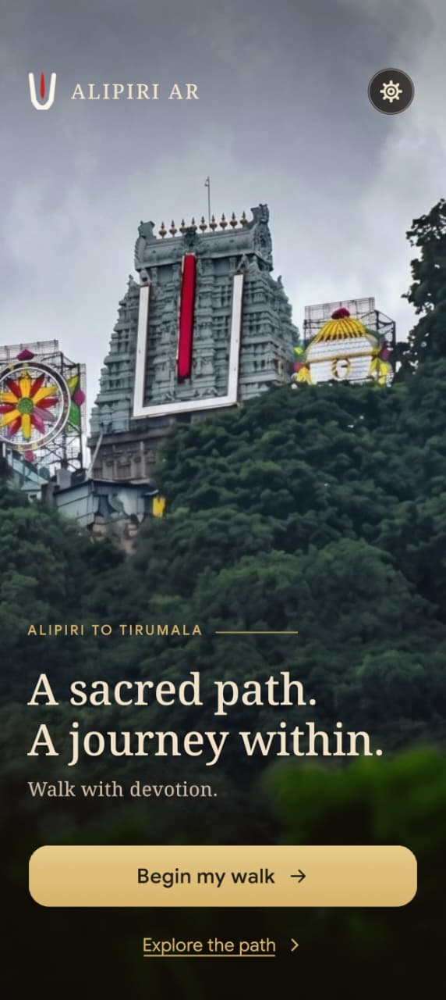
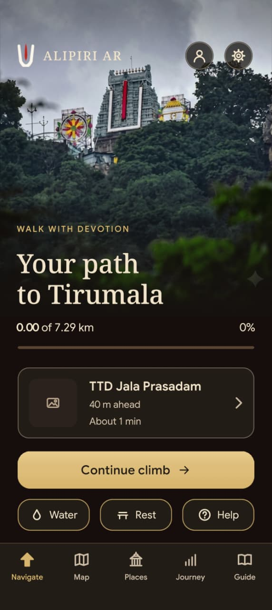
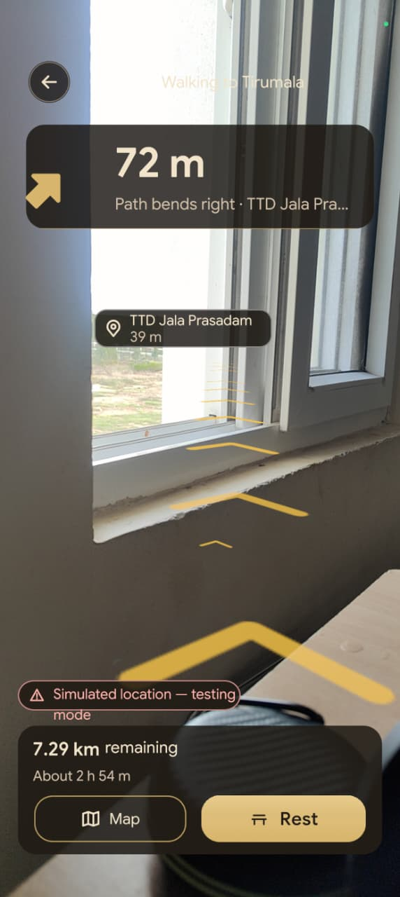
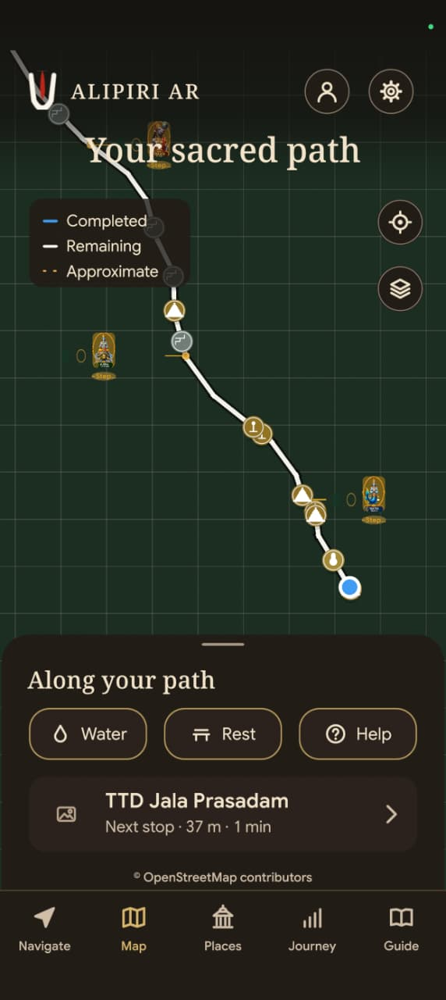
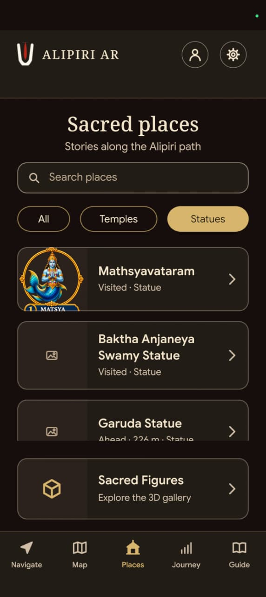
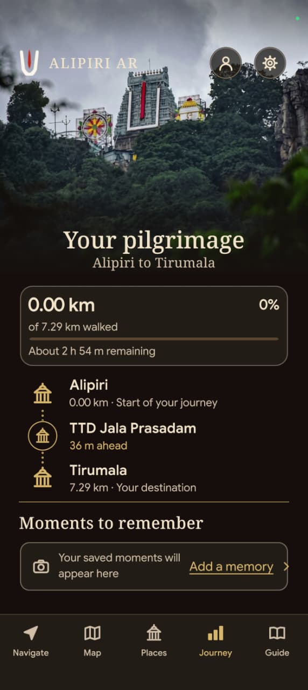
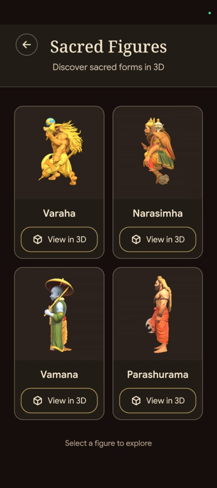
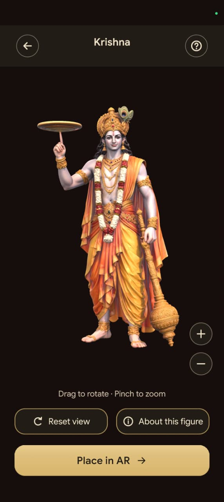

# 🕉️ Alipiri AR Navigation — Sacred Tirumala Pilgrim Wayfinding

<div align="center">


[](https://unity.com/)
[](https://unity.com/)
[](https://docs.unity3d.com/Packages/com.unity.xr.arfoundation@6.5/manual/index.html)
[](https://developers.google.com/ar)
[](https://www.android.com/)
[]()
[]()

**A production-grade, offline-first outdoor Augmented Reality wayfinding and cultural heritage system guiding pilgrims along the historic 7.29 km sacred stone stairway from Alipiri (Tirupati) to Sri Venkateswara Swamy Temple (Tirumala).**

[Executive Summary](#-executive-summary--mission) • [System Architecture](#-system-architecture--engineering) • [App Showcase](#-visual-app-showcase) • [Navigation Engine](#-navigation--positioning-engine) • [Route Geometry](#-route-geometry--analytics) • [Getting Started](#-getting-started--build-guide)

</div>

---

## 📖 Executive Summary & Mission

The **Alipiri Mettu** (`అలిపిరి మెట్టు`) is one of the most revered ancient pedestrian pilgrimage pathways in the world. Ascending through the rugged Eastern Ghats of Andhra Pradesh, India, devotees climb **~3,550 hand-carved granite stone steps** spanning **7.29 to 9.2 kilometers** with an elevation ascent of over **800 to 975 meters** to reach the holy abode of **Lord Sri Venkateswara Swamy** (Tirumala).

Every year, tens of millions of pilgrims undertake this arduous mountain trek on bare feet as an act of profound devotion, penance, and thanksgiving.

```
       [ Alipiri Footway Entrance ] (Tirupati Base, Elev: 150m)
                     │
                     ▼  ~1,000 Steps
            [ Gali Gopuram ] (First Ridge Summit, Elev: 580m)
                     │
                     ▼  Gentle Ascent & Mountain Walk (3.5 km)
            [ Deer Park & Bhashyakarla Sannidhi ]
                     │
                     ▼  Steep Switchbacks (~800 Steps)
            [ Mokalla Parvatham / Mokali Mettu ] (Knee-Breaker Ridge, Elev: 890m)
                     │
                     ▼  Final Stretch
            [ Sri Venkateswara Temple ] (Tirumala Crest, Elev: 975m)
```

### The Real-World Engineering Problem
Walking the Alipiri stairway presents extreme real-world challenges that standard consumer mapping applications (Google Maps, Apple Maps) cannot address:

1. **Severe Cellular Dead Zones & Satellite Occlusion:** Thick jungle canopies, steep granite cliff walls, and deep ravines completely extinguish cellular signals for multiple kilometers. High Multipath GPS reflections bounce off rock faces, causing standard consumer GPS to drift up to 50–100 meters off the actual path.
2. **Physical Exhaustion & Disorientation:** Over a 3.5 to 5-hour uphill climb, pilgrims struggle to estimate true remaining distance, upcoming steep flights, and access to crucial amenities (TTD Jala Prasadam purified water taps, medical aid posts, rest mandapams).
3. **Lost Heritage Context:** The ancient stairway is dotted with 40+ sanctified shrines, mandapams, and stone sculptures representing the **Dashavatara** (Ten Avatars of Lord Vishnu), yet pilgrims often pass them without knowing their history, legends, or spiritual meaning.

### The Solution: Alipiri AR Navigation
**Alipiri AR Navigation** is an engineered Unity 6 / URP / AR Foundation application designed from the ground up for extreme physical environments:
- **100% Offline-First Execution:** Executes all spatial geometry, along-track Kalman filtering, vector mapping, landmark cataloging, and voice synthesis entirely on the phone hardware with zero network reliance.
- **3-Tier AR Ground Placement:** Real-time visual-inertial odometry (VIO) augmented with ground chevrons that hug the physical stairs, preventing drift even across changing light conditions.
- **1D Along-Track Route Snapping:** Projects multi-dimensional noisy GPS updates onto a mathematically surveyed 1D polyline path, eliminating cliff-side position jumping.
- **Cultural & Spiritual Depth:** Complete offline multimedia directory of 40 verified landmarks and an interactive 3D Dashavatara AR museum.

---

## 🏛️ System Architecture & Engineering

The application comprises **91 C# scripts**, **12 active user screens & overlays**, and **over 12,500 lines of code** following a decoupled Service-Oriented Architecture (SOA) powered by an in-house `ServiceLocator`.

```mermaid
graph TD
    subgraph HardwareSensors [Mobile Hardware & Sensor Abstraction]
        GPS[GPS Receiver FineLocation]
        STEP[Step Counter Sensor TYPE_STEP_COUNTER]
        BARO[Barometric Altimeter Sensor]
        CAM[AR Camera & IMU Visual-Inertial Odometry]
    end

    subgraph CoreEngine [Core Services & State Machine]
        AppBoot[AppBootstrap Lifecycle]
        ServiceLoc[ServiceLocator Container]
        ConfidenceSM[NavigationConfidenceMachine]
        ConnService[ConnectivityService Hysteresis]
    end

    subgraph PositioningPipeline [Positioning & Fusion Pipeline]
        Kalman[2D GPS Kalman Filter]
        AlongTrack[AlongTrackEstimator 1D Snapping]
        Fusion[PositionFusionService]
        ProgressTrack[RouteProgressTracker Binary Search]
        EtaModel[EtaEstimator Elevation Non-linear]
        Maneuver[ManeuverDetector Step Guidance]
    end

    subgraph ARSpatial [Augmented Reality Spatial Subsystem]
        ARBoot[ARSessionBootstrapper]
        GroundPlace[GroundPlacementService 3-Tier Fallback]
        HybridEngine[HybridLocalizationEngine]
        ArrowMgr[DynamicArrowManager]
        NavArrow[NavigationArrow Shaders]
        Geospatial[GeospatialSession VPS Terminal Hooks]
    end

    subgraph Presentation [UI Framework & Screens]
        UITheme[UITheme & UIShapes Sacred Palette]
        UIRoot[UIRoot & BackStackManager]
        ARScreen[ARNavigationScreen Live View]
        MapScreen[MapScreen Offline Vector Grid]
        LandmarkScreen[LandmarksScreen & 3D Gallery]
        ProgressScreen[ProgressScreen Elevation & Steps]
        SettingsScreen[SettingsScreen & XLSX Export]
    end

    HardwareSensors --> CoreEngine
    CoreEngine --> PositioningPipeline
    PositioningPipeline --> ARSpatial
    ARSpatial --> Presentation
    PositioningPipeline --> Presentation
```



---

## 📱 Visual App Showcase

The visual interface is designed with a **Sacred Minimalist** philosophy: deep temple onyx backgrounds (`#121212`), sacred gold accents (`#D4AF37`), warm sandstone highlights (`#E6CA65`), and crystal-clear high-contrast typography compliant with harsh midday Indian sunlight.

### 1. Divine Welcome & Sacred Onboarding
Devotees are greeted with a divine darshan of Lord Venkateswara Swamy in Suvarna Alankaram before entering the navigation experience.

| Divine Welcome Gateway | Sacred Path Landing |
|:---:|:---:|
|  |  |
| **Lord Sri Venkateswara Swamy**<br/>Suvarna Alankaram Darshan welcoming devotees to Tirumala | **Alipiri to Tirumala Gateway**<br/>*"A sacred path. A journey within. Walk with devotion."* |

### 2. Navigation Dashboard & Live AR Wayfinding
The core navigation experience transitions seamlessly between high-level pilgrimage metrics and immersive outdoor AR step tracking.

| Navigation Dashboard | Live AR Camera Wayfinding |
|:---:|:---:|
|  |  |
| **Real-time Pilgrim Dashboard**<br/>• Live progress (`0.00 of 7.29 km`)<br/>• Next landmark card (`TTD Jala Prasadam · 40m`)<br/>• Quick amenities filters (Water, Rest, Medical Help)<br/>• Bottom navigation tabs (Navigate, Map, Places, Journey, Guide) | **Outdoor Augmented Reality View**<br/>• Real-time camera feed with golden 3D chevrons<br/>• 3D spatial billboard pin (`TTD Jala Prasadam · 39 m`)<br/>• Turn banner (`72 m · Path bends right`)<br/>• Estimated remaining duration (`2 h 54 m`) |

### 3. Interactive Offline Route Map & Grid Navigation
The Map screen offers an intuitive bird's-eye perspective of the Tirumala ascent with high-performance vector rendering and real-time positioning.

<div align="center">
  
  <p><em>Offline Dark-Theme Vector Grid Map with Live Pilgrim Dot, Multi-Color Trail States, and Temple POIs</em></p>
</div>

- **Dynamic Trail Status Coloring:**
  - <span style="color:#00D2FF">■</span> **Completed Segment (Cyan):** Visualizes path distance already climbed.
  - <span style="color:#D4AF37">■</span> **Remaining Segment (Gold):** Active surveyed route leading up to Tirumala.
  - <span style="color:#FFA500">■</span> **Approximate Segment (Amber):** Straight-line bridged switchback section where satellite geometry is interpolated.
- **Pulsating Live Pilgrim Marker (`UserMarker.cs`):** Smooth lerping GPS blue dot with forward-facing orientation beam indicating cardinal direction.
- **Micro-Callout POI Markers (`PoiMarkerLayer.cs`):** Interactive miniature temple and statue pins displaying name and distance on tap.

---

## 🧭 Navigation & Positioning Engine

The heart of the application is a purpose-built positioning engine located in `Assets/Scripts/Positioning/`, designed to survive severe mountain multipath distortion and canyon GPS degradation.

```
       [ Raw Hardware GPS ] (Lat, Lon, Acc, Speed, Bearing)
                │
                ▼
      [ GpsKalmanFilter ] ─── Reject >3σ velocity spikes & multipath reflection
                │
                ▼
    [ AlongTrackEstimator ] ─── Orthogonal projection onto 1D Polyline space
                │
                ├─── StepCounterSource (Pedestrian Dead Reckoning fallback)
                ├─── BarometerSource (Vertical ascent verification)
                │
                ▼
  [ NavigationConfidenceMachine ] ─── Multi-state trust model
    ├── HighAccuracy (< 8m error)
    ├── DegradedGps (8m - 25m error)
    ├── BridgedZone (Switchback interpolation)
    └── LostLock (> 30s no valid fix)
```

### 1. 1D Along-Track Route Projection
Standard navigation treats position as a free 2D point $(x, y)$. On a steep mountain stairway, a 20-meter lateral GPS drift places the user in an inaccessible jungle ravine.

`AlongTrackEstimator.cs` constrains the user's progress strictly along the 1D arc-length $s \in [0, L]$ of the surveyed route:
$$\text{Project}(P) = \arg\min_{s} \| P - \mathbf{R}(s) \|_2$$
Where $\mathbf{R}(s)$ is the piecewise linear representation of the route polyline. Cross-track error $e_\perp$ is monitored:
$$e_\perp = \| P - \mathbf{R}(s) \|$$
If $e_\perp > 35\text{ m}$, the confidence state machine drops to `DegradedGps` or prompts a sensor recalibration.

### 2. Route Composition & Mathematical Analysis
The route is derived from OpenStreetMap data (`alipiri_mettu.geojson`) parsed by `GeoJsonParser.cs` and chained by `RouteBuilder.cs`.

| OSM Way ID | Vertices | Segment Length | Join Offset | Architectural Role |
|---|---:|---:|---:|---|
| `way/30434845` | 65 | 2,573.7 m | 0.0 m | Alipiri Arch $\to$ Gali Gopuram (Initial steep climb) |
| `way/367434743` | 2 | 7.9 m | 0.0 m | Connector stub |
| `way/367434740` | 12 | 463.1 m | 0.0 m | Mid-mountain flight |
| `way/367434742` | 2 | 15.6 m | 0.0 m | Connector stub |
| `way/367434744` | 47 | 2,167.1 m | **1,171.7 m** | Ascends past Deer Park $\to$ Mountain flank |
| **⚠ Bridged Zone** | — | **1,171.7 m** | — | Straight-line interpolation (`isBridged = true`) |
| `way/30434846` | 33 | 889.5 m | — | Mokalla Mettu $\to$ Tirumala Sri Vari Sannidhi |
| **Total Surveyed** | **157** | **7,288.4 m** | — | **Mean waypoint spacing: 39.6 m (resampled to ~5 m)** |

> [!NOTE]
> **The 1,171.7 m Mountain Gap:** OpenStreetMap has never digitized the switchback steps between coordinates `(13.664720, 79.365567)` and `(13.666465, 79.354873)`. Rather than fabricating a fictitious path, `RouteBuilder.cs` bridges this gap with an amber straight line, and the UI transparently informs the devotee that the path is approximate in this section.

### 4. Sacred Places Directory & Pilgrim Journey Tracker
The spiritual dimension of the pilgrimage is brought alive with rich contextual information and progress tracking.

| Sacred Places & Statues Directory | Pilgrim Journey & Progress Tracker |
|:---:|:---:|
|  |  |
| **Heritage Landmark Directory**<br/>• Instant search across 40 sanctified shrines<br/>• Category filters (`All`, `Temples`, `Statues`)<br/>• Visiting status tracking (`Visited`, `Ahead`)<br/>• Quick portal into the 3D Dashavatara gallery | **Pilgrimage Milestone Progress**<br/>• Vertical milestone timeline (Alipiri $\to$ TTD Jala Prasadam $\to$ Tirumala)<br/>• Accurate progress metrics (`0.00 km of 7.29 km`, `0%`)<br/>• Estimated remaining walk time (`2 h 54 m`)<br/>• Personal reflection journal (*"Moments to remember"*) |

---

## 🏛️ Sacred Heritage & Landmark Architecture

The stairway is accompanied by an offline database (`Assets/StreamingAssets/Database/landmarks.json`) containing **40 verified historical and spiritual landmarks** categorized by architectural and functional purpose.

### 1. Landmark Taxonomy & Schema
Each landmark is represented by `LandmarkData.cs` and loaded into memory on startup:

```json
{
  "id": "landmark_01",
  "name": "Alipiri Padala Mandapam",
  "teluguName": "అలిపిరి పాదాల మండపం",
  "type": "Mandapam",
  "latitude": 13.646761,
  "longitude": 79.405174,
  "routeDistanceMeters": 0.0,
  "estimatedStepIndex": 0,
  "description": "The sacred threshold of the Tirumala hills where Sri Venkateswara Swamy left His holy divine footprints.",
  "voiceText": "Approaching Alipiri Padala Mandapam. Offer your prayers at the divine footprints before beginning the ascent."
}
```

| Type Category | Count | Key Landmarks | In-App Visual Representation |
|---|---:|---|---|
| `Gopuram` | 4 | Alipiri Arch, Gali Gopuram, Mokalla Gopuram, Tirumala Mada Veedhi | Golden temple tower badge with procedural facade |
| `Statue` | 14 | Mathsyavataram, Kurmavataram, Baktha Anjaneya, Garuda Statue, etc. | Sculpted sandstone glyph & direct link to 3D model |
| `Mandapam` | 11 | Padala Mandapam, Ganta Mandapam, Dorasani Mandapam | Ancient pillared pavilion icon |
| `JalaPrasadam` | 6 | TTD Free Purified Mineral Water stations (every ~1.2 km) | Cyan water droplet with instant proximity alert |
| `Medical & Aid` | 3 | TTD First Aid dispensaries & emergency oxygen booths | Emergency cross with direct distance meter |
| `Temple` | 2 | Sri Lakshmi Narasimha Swamy Temple, Bhashyakarla Sannidhi | Sanctum sanctorum icon with audio stotram cue |

### 2. Spatial Geofencing (`LandmarkTriggerService.cs`)
As the pilgrim ascends, `LandmarkTriggerService` checks the projected along-track distance against the milestone array:
- **Proximity Alert ($\le 50\text{ m}$):** Shows the `TurnInstructionCard` overlay and prepares audio narration.
- **Arrival Trigger ($\le 15\text{ m}$):** Triggers `ArrivalCard` and registers the landmark into `VisitedStore.cs`.
- **Text-To-Speech Synthesis:** Native `AndroidTextToSpeech.cs` reads the sacred lore in the background without needing internet connectivity.

### 3. Local Pilgrimage Journal & Dependency-Free Excel Writer
To preserve memories and record devotion stats, `ProfileService.cs` logs pilgrimage sessions into a local Open Office XML spreadsheet (`Assets/login.xlsx`):
- Uses `XlsxWriter.cs` — a 100% dependency-free, zero-DLL custom OOXML ZIP generator.
- Stores devotee Name, Age, Chosen Language, Date, Start Time, Completion Time, Estimated Steps climbed, and Calories burned.
- Pilgrim can export this file using the Android Native Share Sheet via `FileProvider`.

### 5. Sacred Figures 3D Gallery & Interactive AR Viewer
A standout cultural feature of Alipiri AR Navigation is the preservation and exploration of the sacred **Dashavatara** (Ten Incarnations of Lord Vishnu) sculptures located along the stairway.

| Dashavatara 3D Sacred Gallery | Interactive 3D Model & AR Placement |
|:---:|:---:|
|  |  |
| **Sacred Figures Gallery**<br/>• Full interactive 3D catalogue<br/>• Varaha, Narasimha, Vamana, Parashurama<br/>• Direct "View in 3D" model loader<br/>• Scriptural history & avatar descriptions | **360° Interactive 3D AR Viewer**<br/>• Lord Sri Krishna with Sudarshana Chakra & Gada<br/>• Full touch gestures (Drag to rotate, pinch to zoom)<br/>• *"Place in AR"* button for ground plane projection<br/>• Reset view and devotional iconography |

---

## 👁️ Outdoor Augmented Reality Engine

The outdoor Augmented Reality wayfinding pipeline (`Assets/Scripts/AR/`) overcomes the extreme visual challenges of outdoor stone staircases, severe solar glare, and moving crowds.

### 1. 3-Tier Ground Placement System (`GroundPlacementService.cs`)
Standard AR tracking assumes flat indoor floors. Outdoor stone steps present disjointed, jagged elevation planes with fluctuating shadows. The placement service implements a robust 3-tier cascade:

```
[Tier 1: AR Plane Raycasting] ─── Hits detected ARCore Horizontal Plane
           │ (Fails on untextured stairs)
           ▼
[Tier 2: Feature Point Cloud] ─── Samples nearest sparse feature points within 0.5m radius
           │ (Fails under extreme sunlight)
           ▼
[Tier 3: Camera Down-Vector]  ─── Projects ray down from camera pose at estimated ground height (~1.4m)
```

- **Vertical Wall Rejection:** To prevent chevrons from projecting onto steep cliff walls or doorway frames, `ARSessionBootstrapper.cs` strictly configures `PlaneDetectionMode.Horizontal` and enforces a vertical surface threshold (`MinGroundUpDot = 0.707`), rejecting any plane tilted more than 45 degrees.

### 2. Golden Chevron Arrow Visuals (`NavigationArrow.cs` & `DynamicArrowManager.cs`)
- **Procedural Curve Conformance:** Waypoints resampled at ~5-meter intervals generate a smooth Catmull-Rom spline curving naturally along the bends of the stairway.
- **Surface-Hugging Chevrons:** Rather than floating high in the air, 3D chevrons are oriented with their normal matching the estimated slope of the flight of stairs, rotating flat into the ground plane.
- **Pulsating Sacred Gold Glow:** Rendered using a lightweight URP unlit custom shader with additive alpha blending, ensuring high visibility under bright outdoor Indian sunlight without consuming excessive GPU fill-rate.

### 3. Spatial Anchor Coordinate Transformation (`GeoAnchorFrame.cs`)
Converts spherical Earth coordinates $(\phi, \lambda, h)$ into local Unity metric Cartesian coordinates $(X, Y, Z)$:
$$\Delta X = R \cdot (\lambda - \lambda_0) \cdot \cos\left(\frac{\phi + \phi_0}{2}\right)$$
$$\Delta Z = R \cdot (\phi - \phi_0)$$
$$\Delta Y = h - h_0$$
Where $R \approx 6,371,000\text{ m}$ is the mean Earth radius. This allows GPS waypoints up to 500 meters ahead to be placed into the AR camera frustum with high geometric fidelity.

---
