# 🕉️ Alipiri AR Navigation — Sacred Tirumala Pilgrim Wayfinding

<div align="center">


[](https://unity.com/)
[](https://unity.com/)
[](https://docs.unity3d.com/Packages/com.unity.xr.arfoundation@6.5/manual/index.html)
[](https://developers.google.com/ar)
[](https://www.android.com/)
[]()
[]()

**A production-grade, offline-first outdoor Augmented Reality wayfinding and cultural heritage system guiding pilgrims along the historic 7.29 km sacred stone stairway from Alipiri (Tirupati) to Sri Venkateswara Swamy Temple (Tirumala).**

[Executive Summary](#-executive-summary--mission) • [System Architecture](#-system-architecture--engineering) • [App Showcase](#-visual-app-showcase) • [Navigation Engine](#-navigation--positioning-engine) • [Route Geometry](#-route-geometry--analytics) • [Getting Started](#-getting-started--build-guide)

</div>

---

## 📖 Executive Summary & Mission

The **Alipiri Mettu** (`అలిపిరి మెట్టు`) is one of the most revered ancient pedestrian pilgrimage pathways in the world. Ascending through the rugged Eastern Ghats of Andhra Pradesh, India, devotees climb **~3,550 hand-carved granite stone steps** spanning **7.29 to 9.2 kilometers** with an elevation ascent of over **800 to 975 meters** to reach the holy abode of **Lord Sri Venkateswara Swamy** (Tirumala).

Every year, tens of millions of pilgrims undertake this arduous mountain trek on bare feet as an act of profound devotion, penance, and thanksgiving.

```
       [ Alipiri Footway Entrance ] (Tirupati Base, Elev: 150m)
                     │
                     ▼  ~1,000 Steps
            [ Gali Gopuram ] (First Ridge Summit, Elev: 580m)
                     │
                     ▼  Gentle Ascent & Mountain Walk (3.5 km)
            [ Deer Park & Bhashyakarla Sannidhi ]
                     │
                     ▼  Steep Switchbacks (~800 Steps)
            [ Mokalla Parvatham / Mokali Mettu ] (Knee-Breaker Ridge, Elev: 890m)
                     │
                     ▼  Final Stretch
            [ Sri Venkateswara Temple ] (Tirumala Crest, Elev: 975m)
```

### The Real-World Engineering Problem
Walking the Alipiri stairway presents extreme real-world challenges that standard consumer mapping applications (Google Maps, Apple Maps) cannot address:

1. **Severe Cellular Dead Zones & Satellite Occlusion:** Thick jungle canopies, steep granite cliff walls, and deep ravines completely extinguish cellular signals for multiple kilometers. High Multipath GPS reflections bounce off rock faces, causing standard consumer GPS to drift up to 50–100 meters off the actual path.
2. **Physical Exhaustion & Disorientation:** Over a 3.5 to 5-hour uphill climb, pilgrims struggle to estimate true remaining distance, upcoming steep flights, and access to crucial amenities (TTD Jala Prasadam purified water taps, medical aid posts, rest mandapams).
3. **Lost Heritage Context:** The ancient stairway is dotted with 40+ sanctified shrines, mandapams, and stone sculptures representing the **Dashavatara** (Ten Avatars of Lord Vishnu), yet pilgrims often pass them without knowing their history, legends, or spiritual meaning.

### The Solution: Alipiri AR Navigation
**Alipiri AR Navigation** is an engineered Unity 6 / URP / AR Foundation application designed from the ground up for extreme physical environments:
- **100% Offline-First Execution:** Executes all spatial geometry, along-track Kalman filtering, vector mapping, landmark cataloging, and voice synthesis entirely on the phone hardware with zero network reliance.
- **3-Tier AR Ground Placement:** Real-time visual-inertial odometry (VIO) augmented with ground chevrons that hug the physical stairs, preventing drift even across changing light conditions.
- **1D Along-Track Route Snapping:** Projects multi-dimensional noisy GPS updates onto a mathematically surveyed 1D polyline path, eliminating cliff-side position jumping.
- **Cultural & Spiritual Depth:** Complete offline multimedia directory of 40 verified landmarks and an interactive 3D Dashavatara AR museum.

---

## 🏛️ System Architecture & Engineering

The application comprises **91 C# scripts**, **12 active user screens & overlays**, and **over 12,500 lines of code** following a decoupled Service-Oriented Architecture (SOA) powered by an in-house `ServiceLocator`.

```mermaid
graph TD
    subgraph HardwareSensors [Mobile Hardware & Sensor Abstraction]
        GPS[GPS Receiver FineLocation]
        STEP[Step Counter Sensor TYPE_STEP_COUNTER]
        BARO[Barometric Altimeter Sensor]
        CAM[AR Camera & IMU Visual-Inertial Odometry]
    end

    subgraph CoreEngine [Core Services & State Machine]
        AppBoot[AppBootstrap Lifecycle]
        ServiceLoc[ServiceLocator Container]
        ConfidenceSM[NavigationConfidenceMachine]
        ConnService[ConnectivityService Hysteresis]
    end

    subgraph PositioningPipeline [Positioning & Fusion Pipeline]
        Kalman[2D GPS Kalman Filter]
        AlongTrack[AlongTrackEstimator 1D Snapping]
        Fusion[PositionFusionService]
        ProgressTrack[RouteProgressTracker Binary Search]
        EtaModel[EtaEstimator Elevation Non-linear]
        Maneuver[ManeuverDetector Step Guidance]
    end

    subgraph ARSpatial [Augmented Reality Spatial Subsystem]
        ARBoot[ARSessionBootstrapper]
        GroundPlace[GroundPlacementService 3-Tier Fallback]
        HybridEngine[HybridLocalizationEngine]
        ArrowMgr[DynamicArrowManager]
        NavArrow[NavigationArrow Shaders]
        Geospatial[GeospatialSession VPS Terminal Hooks]
    end

    subgraph Presentation [UI Framework & Screens]
        UITheme[UITheme & UIShapes Sacred Palette]
        UIRoot[UIRoot & BackStackManager]
        ARScreen[ARNavigationScreen Live View]
        MapScreen[MapScreen Offline Vector Grid]
        LandmarkScreen[LandmarksScreen & 3D Gallery]
        ProgressScreen[ProgressScreen Elevation & Steps]
        SettingsScreen[SettingsScreen & XLSX Export]
    end

    HardwareSensors --> CoreEngine
    CoreEngine --> PositioningPipeline
    PositioningPipeline --> ARSpatial
    ARSpatial --> Presentation
    PositioningPipeline --> Presentation
```



---

## 📱 Visual App Showcase

The visual interface is designed with a **Sacred Minimalist** philosophy: deep temple onyx backgrounds (`#121212`), sacred gold accents (`#D4AF37`), warm sandstone highlights (`#E6CA65`), and crystal-clear high-contrast typography compliant with harsh midday Indian sunlight.

### 1. Divine Welcome & Sacred Onboarding
Devotees are greeted with a divine darshan of Lord Venkateswara Swamy in Suvarna Alankaram before entering the navigation experience.

| Divine Welcome Gateway | Sacred Path Landing |
|:---:|:---:|
|  |  |
| **Lord Sri Venkateswara Swamy**<br/>Suvarna Alankaram Darshan welcoming devotees to Tirumala | **Alipiri to Tirumala Gateway**<br/>*"A sacred path. A journey within. Walk with devotion."* |

### 2. Navigation Dashboard & Live AR Wayfinding
The core navigation experience transitions seamlessly between high-level pilgrimage metrics and immersive outdoor AR step tracking.

| Navigation Dashboard | Live AR Camera Wayfinding |
|:---:|:---:|
|  |  |
| **Real-time Pilgrim Dashboard**<br/>• Live progress (`0.00 of 7.29 km`)<br/>• Next landmark card (`TTD Jala Prasadam · 40m`)<br/>• Quick amenities filters (Water, Rest, Medical Help)<br/>• Bottom navigation tabs (Navigate, Map, Places, Journey, Guide) | **Outdoor Augmented Reality View**<br/>• Real-time camera feed with golden 3D chevrons<br/>• 3D spatial billboard pin (`TTD Jala Prasadam · 39 m`)<br/>• Turn banner (`72 m · Path bends right`)<br/>• Estimated remaining duration (`2 h 54 m`) |

---
